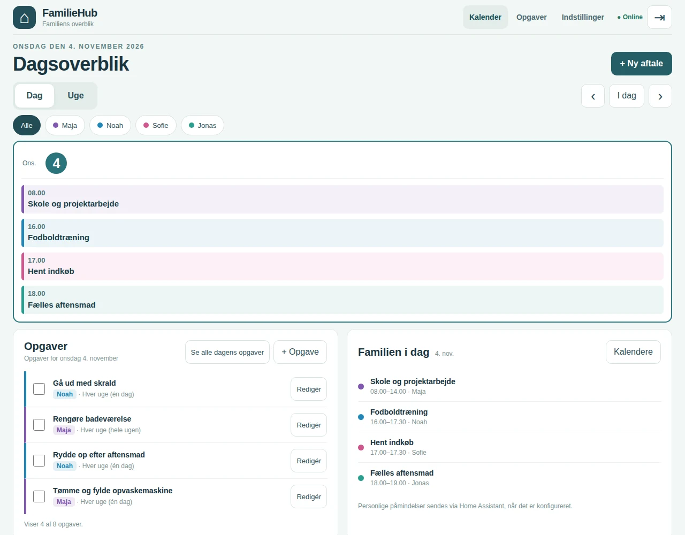
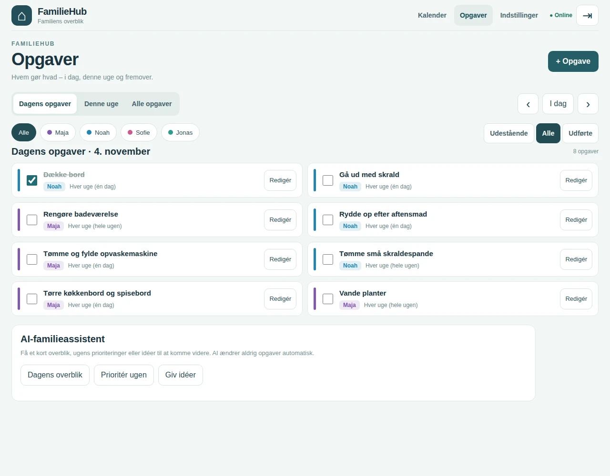
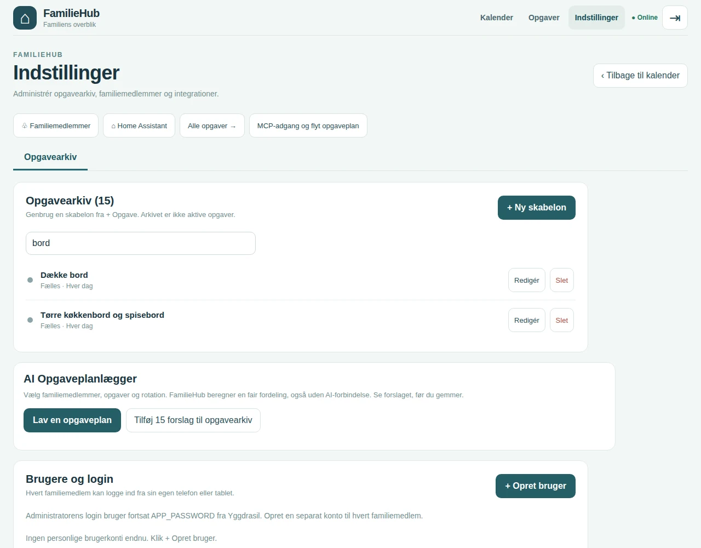
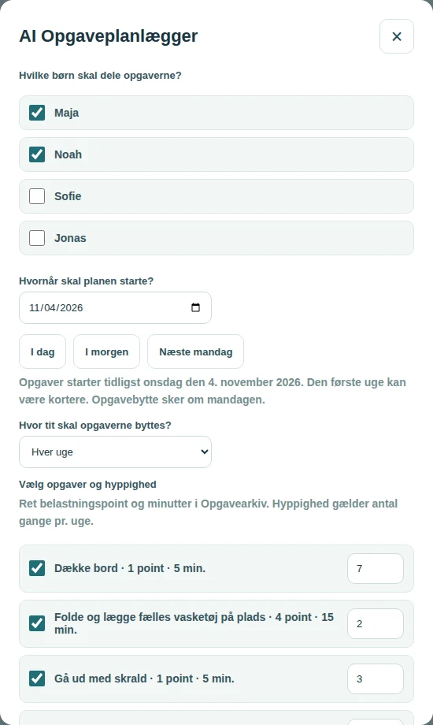
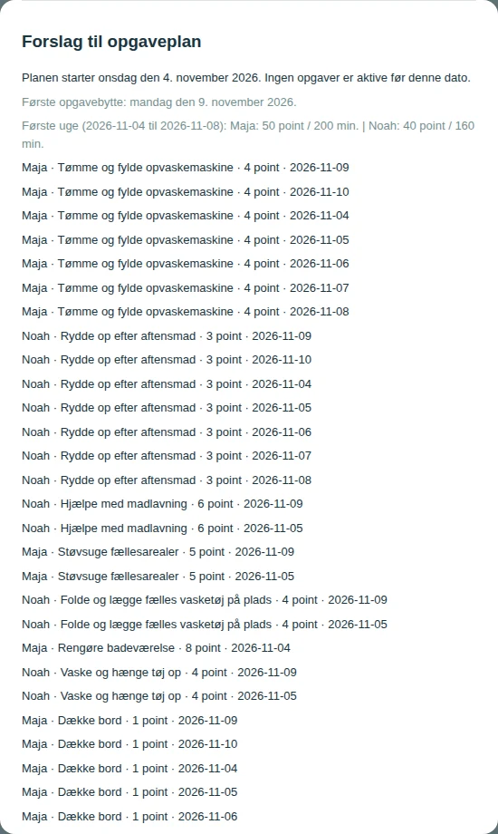
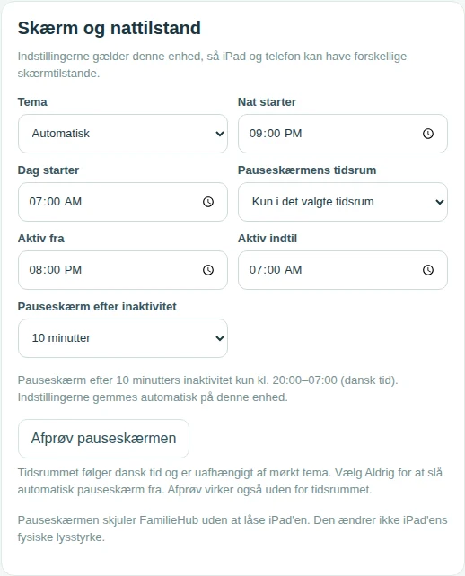
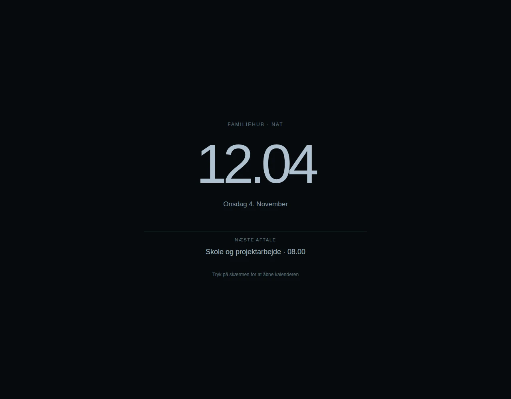
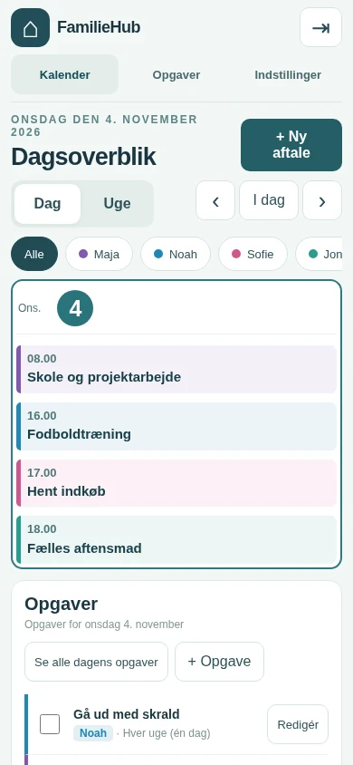
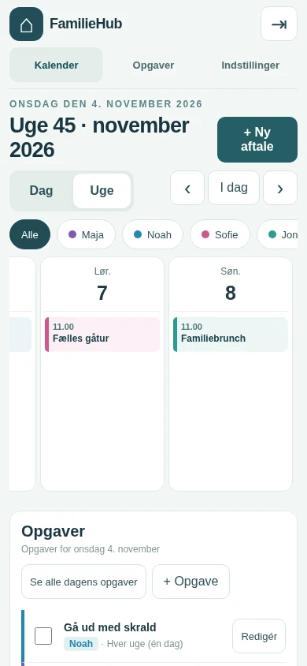

# FamilieHub

En selvhostet familiekalender og opgavetavle til tablet, iPad og telefon.
**Go + SQLite + almindelig HTML/CSS/JavaScript**, pakket som én Docker-container til Yggdrasil.
Frontend er udviklet med iPadOS 15 som kompatibilitetsmål; der er ingen produktionsafhængighed af Node eller npm.

[](https://github.com/kw-aficionado/familiehub/actions/workflows/ci.yml)
[](https://github.com/kw-aficionado/familiehub/actions/workflows/release.yml)

**Dokumentation gennemgået 4. november 2026.** Appens versionsetiket og den eksisterende Rune bruger fortsat `0.1.1`; det konkrete build identificeres af Git-committen i footeren og `/api/version`.

[Kom i gang](#kom-i-gang) · [Skærmbilleder](#skærmbilleder) · [Arbejd videre i Codex](docs/CODEX.md) · [MCP](docs/MCP.md) · [Pauseskærm](docs/SCREENSAVER.md)

## Funktioner og navigation

| Område | Det kan du |
| --- | --- |
| **Kalender** | Forsiden starter i **Dag**. Vælg også Uge, skift dato, filtrér på familiemedlem, og opret lokale aftaler med eventuel afhentningsansvarlig. |
| **Dagens opgaver** | Forsiden viser op til fire opgaver. **Se alle dagens opgaver** åbner den fulde liste for den viste dag — ikke alle opgaveserier på tværs af datoer. Personfilteret følger med. |
| **Opgaver** | Vælg **Dagens opgaver**, **Denne uge** eller **Alle opgaver**. Dag og uge understøtter afkrydsning og filtre for udestående/udførte opgaver. |
| **Opgavearkiv** | Genbrugelige skabeloner med kategori, minutter, belastningspoint, gentagelse og hyppighed. Arkivet ligger under **Indstillinger**. |
| **AI Opgaveplanlægger** | Ligger **lige under Opgavearkiv i Indstillinger**. Fordel pligter efter arbejdsbyrde, vælg startdato og rotation, se forslaget, og godkend før lagring. |
| **AI-familieassistent** | På Opgaver: dagens overblik, ugens prioriteringer og idéer. Bruger den konfigurerede AI-udbyder; opgaver ændres ikke af et AI-svar. |
| **Skærm** | Lyst/mørkt tema og pauseskærm med eget tidsrum. Standard: automatisk pauseskærm kl. **20.00–07.00**, efter inaktivitet. Gemmes pr. enhed. |
| **Konti og integrationer** | Individuelle logins, Home Assistant, direkte kalenderforbindelser, e-mail, Web Push og valgfri scoped MCP-adgang. |

### Kalender og dagens opgaver

**Familien i dag** bruger den faktiske dato i `Europe/Copenhagen`, også når en anden kalenderdag vises.
Hvis en anden dag er valgt på forsiden, hedder opgavegenvejen **Se alle opgaver denne dag** og følger den valgte dag. Dagslisten har ikke forsides begrænsning på fire kort.
**Dagens opgaver** og **I dag** vender tilbage til familiens aktuelle dato. Ugevisningen og kataloget **Alle opgaver** kan fortsat vælges særskilt.

Gentagelser omfatter én dag, dagligt, hverdage, hver uge, hver anden uge samt opgaver, der kan løses i løbet af en hel uge. En hele-uge-opgave afkrydses én gang for den pågældende uge. Daglige forekomster har hver deres afkrydsning.

### Planlæg pligter

Åbn **Indstillinger → AI Opgaveplanlægger**, direkte under **Opgavearkiv**.

1. Tilføj eventuelt **15 forslag til opgavearkiv**. Eksisterende skabeloner bevares.
2. Vælg **Lav en opgaveplan**, familiemedlemmer, pligter og hyppighed. Point og minutter kan redigeres i arkivet.
3. Vælg **Hvornår skal planen starte?** Standard er i dag. Genveje: I dag, I morgen og Næste mandag. Alle ugedage accepteres.
4. Vælg rotation: ingen, hver uge, hver anden uge eller hver fjerde uge. Vælg eventuelt en foretrukken og en mindre ønsket opgave pr. person.
5. Beregn og gennemgå forslaget; bed eventuelt AI om en vurdering. Vælg derefter **Godkend og gem opgaveplan**.

Efter gemning bliver du i Indstillinger med en kvittering og linket **Se den gemte opgaveplan**, som åbner startugen.
En start midt i ugen giver en kortere første uge; belastning og første opgavebytte vises særskilt.
Ingen forekomster, afkrydsninger eller påmindelser gælder før planens start. Rotation følger kalenderuger med bytte om mandagen. Se [startdatoens præcise regler](docs/PLANNER-START.md).

Fordelingen beregnes af almindelig kode og virker uden AI-forbindelse. AI forklarer forslaget; den har ikke fri skriveadgang til databasen. Belastningspoint er familiens justerbare skøn, ikke en objektiv måling.
Kun administratoren importerer standardskabeloner; indloggede familiemedlemmer kan gemme planer ligesom almindelige opgaver.

**Undgå dubletter:** En ny godkendelse af en nyoprettet plan kan oprette endnu et sæt tilbagevendende opgaver. Kontrollér eksisterende planer før gentagen oprettelse. Planlæggeren sletter ikke gamle opgaver automatisk.

### Pauseskærm og ikon

Under **Indstillinger → Skærm og nattilstand** kan du vælge pauseskærmens tidsrum, **Aktiv fra**, **Aktiv indtil** og inaktivitetstid. Standardtidsrummet er **20.00–07.00 dansk tid**; på nye enheder er forsinkelsen 10 minutter. Vælg **Hele døgnet** eller **Aldrig** efter behov.
Eksisterende indstillinger bevares, også en deaktiveret pauseskærm. Temaets nattetider er uafhængige. **Afprøv pauseskærmen** er manuel og virker også uden for tidsrummet. Se [pauseskærmsvejledningen](docs/SCREENSAVER.md).

Hus-ikonet bruges som SVG-favicon, ICO-fallback og 180 × 180 Apple touch-ikon. Pauseskærmen ændrer ikke enhedens fysiske lysstyrke eller iPadOS' egen skærmlås.

## Skærmbilleder

**Rigtige browseroptagelser af denne apps frontend og Go-backend med fiktive demodata i en ny, midlertidig SQLite-database.** Ingen private familiedata, kalenderforbindelser eller API-nøgler er brugt. Footeren viser derfor `Build demo`.
Optagelserne er ikke et bevis på drift af eksterne integrationer eller fysisk Safari på en iPad.
Dato, kildefilernes hashværdier, browser og billedhashes fremgår af [manifestet](docs/screenshots/manifest.json). [Sådan genoptages billederne](docs/SCREENSHOTS.md).

### Forside i Dag



### Dagens fulde opgaveliste



### Opgavearkiv og planlægger under Indstillinger

Arkivet er her filtreret på **bord**, så placeringen af planlæggeren umiddelbart under arkivet er synlig.



### Planens startdato og godkendelse

| Vælg startdato og opgaver | Gennemgå fordelingen før lagring |
| --- | --- |
|  |  |

### Pauseskærmens indstillinger





### Telefon

| Dag som startvisning | Ugevisning rullet til søndag |
| --- | --- |
|  |  |

## Integrationer og adgang

### Kalender

Home Assistant er **valgfri**, ikke et krav for alle eksterne kalendere.
**Indstillinger → Direkte kalenderforbindelser** understøtter Google Kalender, Microsoft 365, iCloud/CalDAV og ICS-feeds. Google/Microsoft kræver egen OAuth-konfiguration; iCloud bruger en kalenderadresse og en app-specifik adgangskode. Eksterne forbindelser er skrivebeskyttede. Lokale FamilieHub-aftaler skrives ikke tilbage til Google/iCloud/Microsoft.

Home Assistant kan bruges via `HA_URL`, `HA_TOKEN` og `HA_CALENDARS`. Forbindelsen skal virke fra **FamilieHub-serveren**, ikke kun fra brugerens telefon eller browser. Brug en privat forbindelse til HA frem for at eksponere HA direkte.

Kalendere kan knyttes til en standardperson. Person-tags i aftaletitler, fx `#Maja #Sport Træning`, kan angive farve/tilhørsforhold; flere personer kan få en delt farvestribe. Kategorier omfatter Sport, Skole, Arbejde, Hjemme, Familie, Fritid, Privat og Legeaftale. Tags ændrer ikke den eksterne kalender.

### AI og påmindelser

Konfigurér frivilligt OpenAI API, Claude/Anthropic eller en OpenAI-kompatibel server under **Indstillinger → AI og påmindelser**. Indtast udbyderens API-modelnavn og eventuel nøgle; et chatabonnement er ikke i sig selv en API-nøgle.
Planlægning og gentagelser fungerer uden AI. Ved fejl i AI-påmindelser bruges almindelig tekst. Start ikke fejlfinding ved at slette familiens data.

Personlige beskeder kan bruge Home Assistant, Web Push eller e-mail. SMTP konfigureres under Indstillinger; remote SMTP kræver kryptering. Web Push afhænger af browser/enhed og tilladelser. iPad Air 2 understøtter ikke den nyere iOS Web Push-funktion; e-mail er et alternativ.
Påmindelser kan aktiveres med et valgt tidspunkt og deduplikeres over genstarter. Hele-uge-opgaver håndteres som én forekomst; daglige opgaver hver for sig. Lokale legeaftaler kan desuden have en afhentningspåmindelse.

### Logins og MCP

Administrator bruger `APP_PASSWORD` og tomt brugernavn eller `admin`. Under **Brugere og login** kan administrator oprette individuelle konti, deaktivere dem og nulstille koder. Medlemmer kan skifte egen kode. Alle indloggede familiemedlemmer har adgang til den fælles familievisning; det er ikke en flerlejerløsning med privat kalender pr. konto.

[MCP-adgang](docs/MCP.md) er slået fra som standard. Administrator kan oprette OAuth-klienter med PKCE og begrænsede scopes, godkende og tilbagekalde adgang. Værktøjerne læser familie-/opgaveoplysninger og kan med skriverettighed forhåndsvise og anvende en godkendt planflytning. De giver ikke vilkårlig SQL- eller hemmelighedsadgang.
Planflytning bevarer opgave-id'er og rotation, afviser afkrydset historik og beskytter mod gentagne kald. Den kan også udføres direkte i appens administrative side uden ekstern MCP-klient.

## Kom i gang

### Lokal udvikling og Codex

Krav: **Go 1.23+**, CGO, C-compiler, SQLite-developmentpakke og **Node 22+** til browserregressionstests. Python/Playwright er kun nødvendige til screenshots.

```sh
git clone https://github.com/kw-aficionado/familiehub.git
cd familiehub
sh scripts/setup-dev.sh
sh scripts/check.sh
go build -o familiehub .
```

Angiv en stærk adgangskode i det lokale miljø, og start med en **separat udviklingsdatamappe**:

```sh
APP_URL=http://localhost:8080 DATA_DIR=./data-dev ./familiehub -listen 127.0.0.1:8080
```

`APP_PASSWORD` skal allerede være sat i miljøet (mindst 12 tegn). Commit aldrig adgangskoden, data eller `session.key`.
Se [Codex-overdragelsen](docs/CODEX.md) og [projektreglerne](AGENTS.md) for arbejdsgang, projektbeslutninger og første prompt.
Tilføj den eksisterende repositorymappe som projekt i Codex; der skal ikke oprettes et nyt FamilieHub-repository eller flyttes produktionsdata.

### Docker og Yggdrasil

Eksisterende image: **`ghcr.io/kw-aficionado/familiehub:0.1.1`**. Rune: [`rune/familiehub.yaml`](rune/familiehub.yaml).
Dette er én container, ikke en Docker Compose-stack.

```sh
docker run -d --name familiehub -p 8080:8080 \
  -e APP_PASSWORD \
  -e APP_URL=http://localhost:8080 \
  -v familiehub-data:/data \
  ghcr.io/kw-aficionado/familiehub:0.1.1
```

Forudsætning: `APP_PASSWORD` er eksporteret i shellens miljø. Brug HTTPS og en passende `APP_URL` ved ekstern adgang.
GHCR-pakken skal kunne hentes offentligt, eller Yggdrasil skal have registry-adgang.
I Yggdrasil importeres repository `kw-aficionado/familiehub`, mappen `rune`, branch `main`.
Opret serveren én gang med vedvarende `/data`, angiv indstillingerne, og aktivér ønsket netværk/HTTPS og autostart.

| Variabel | Formål |
| --- | --- |
| `APP_PASSWORD` | Administratoradgangskode, mindst 12 tegn. Hemmelig. |
| `APP_URL` | Den faktiske adresse, som bruges til appen; HTTPS ved ekstern adgang. |
| `DATA_DIR` | Datamappe; Docker bruger `/data`. |
| `HA_URL` | Valgfri Home Assistant-baseadresse, tilgængelig fra serveren. |
| `HA_TOKEN` | Valgfri HA-hemmelighed; aldrig i frontend eller Git. |
| `HA_CALENDARS` | Valgfri kommasepareret liste af `calendar.*`-entities. |

### Opdatering og backup

Push til `main` starter både test og Docker-publicering. **Kontrollér publiceringens grønne resultat**, ikke kun testjobbet, før opdatering.
`0.1.1` er i det eksisterende udviklingsflow et mutable tag. Opdatér/træk imaget og genstart **den eksisterende server**, og kontrollér build-hashen nederst i appen eller via `/api/version`.
En lokal test eller GitHub-merge er ikke bevis på, at produktionsserveren allerede kører den nye kode.

**Behold samme datavolumen. Brug ikke Wipe.** Backup skal indeholde både `familiehub.sqlite` og `session.key`. Sessionsnøglen bruges også til beskyttede integrationsoplysninger; tab af nøglen kan gøre dem ulæselige.
Stop appen før en almindelig filbaseret SQLite-backup/restore for at få en konsistent kopi. Brug kun en understøttet SQLite-backupmetode til hot-backup.

## Test og dokumentation

```sh
sh scripts/check.sh
```

Kommandoen kører Go-tests, race-tests, alle Node-regressionstests, syntakskontrol af alle browser-JavaScriptfiler og et midlertidigt build.
Skærmbilleder kan regenereres med [det isolerede demoscript](docs/SCREENSHOTS.md).

- [Codex og udvikleroverdragelse](docs/CODEX.md)
- [MCP, OAuth og planflytning](docs/MCP.md)
- [Startdato og rotation](docs/PLANNER-START.md)
- [Pauseskærmens tidsrum](docs/SCREENSAVER.md)
- [Skærmbilleder og proveniens](docs/SCREENSHOTS.md)
- [Roadmap](ROADMAP.md)

### Afgrænsninger

Appen kræver forbindelse til backend; der er ingen komplet offline-cache.
Eksterne kalendere er læsning, ikke tovejssynkronisering. Der er ingen færdig ChoreOps-adapter eller dedikeret Nest Hub-castskærm.
Aldersstyret planlægning, fraværsstyring og en fuld samtalebaseret agent er ikke færdige funktioner i denne udgave.
Chromium-regressionstests og screenshots erstatter ikke fysisk afprøvning på iPadOS 15, ægte pushlevering eller godkendelse hos eksterne kalender-/AI-udbydere.
