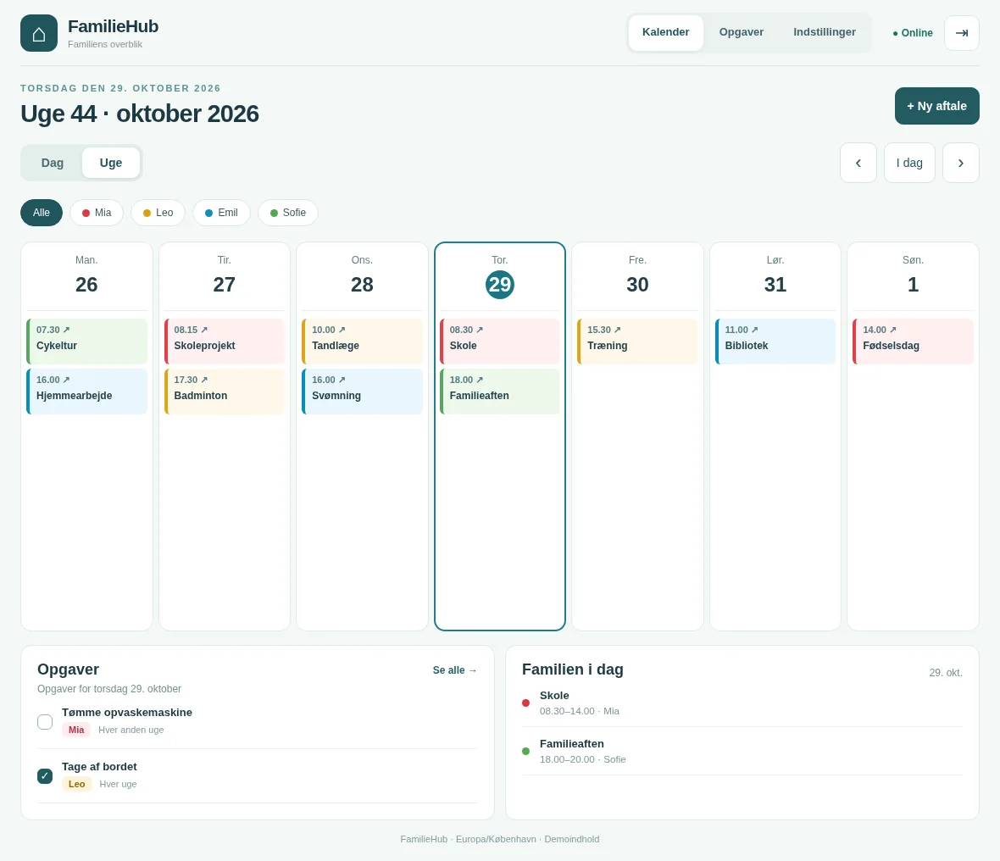
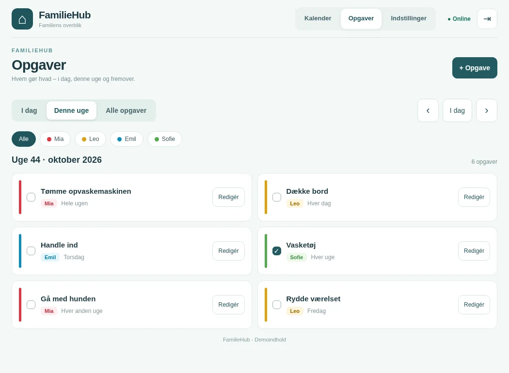
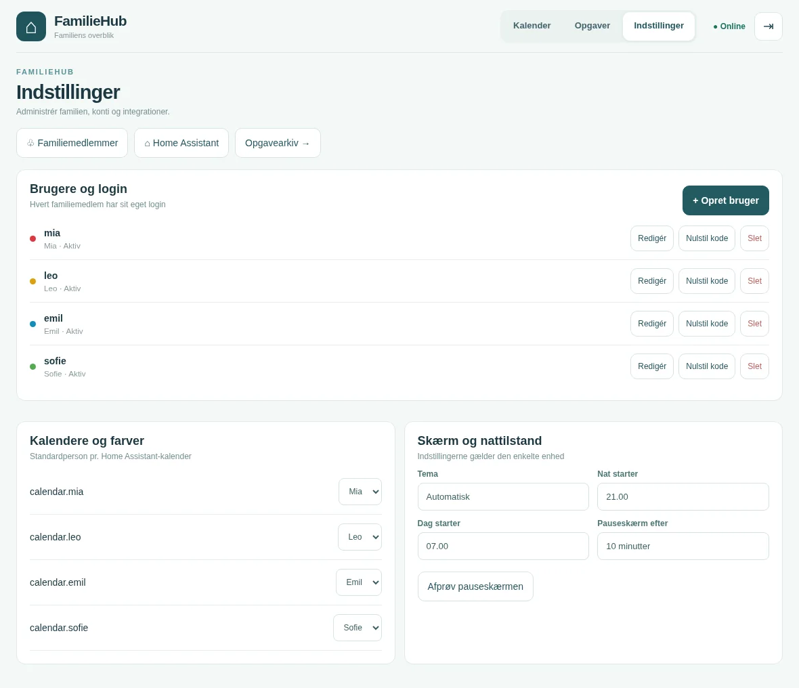
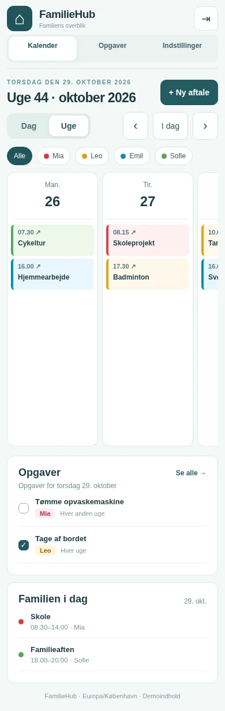
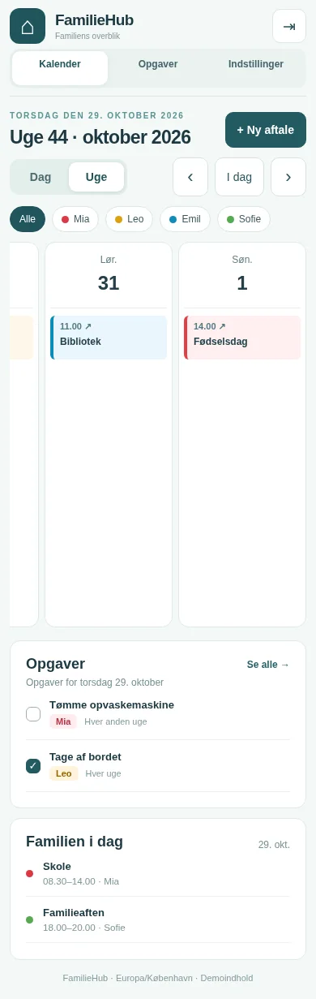
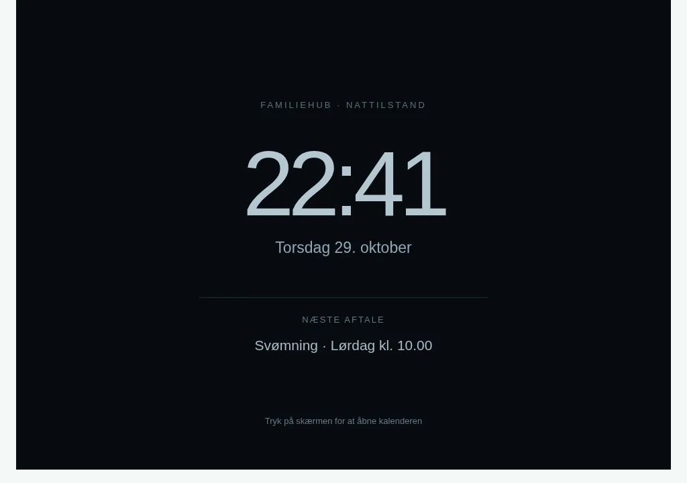

# FamilieHub v0.1.1 – familiekalender som Yggdrasil Rune

En selvhostet familietavle til iPad Air 2, nyere tablets og telefoner.

**Status:** Kørbar MVP. Go + SQLite + indlejret HTML/CSS/JavaScript (ingen npm-afhængigheder). Designet med browserkompatibilitet til iPadOS 15. Docker-imaget bygges automatisk via GitHub Actions ved push til `main`. Runen kræver, at dette workflow er gennemført, og at GHCR-pakken er offentligt tilgængelig (eller Yggdrasil har registry-adgang).


## AI Opgaveplanlægger (ny)

Åbn **Opgaver → AI Opgaveplanlægger**. Funktionen genbruger FamilieHubs eksisterende login, AI-udbyder og API-nøgle.

1. Vælg **Tilføj 15 forslag til opgavearkiv**. Dette opretter kun manglende skabeloner; eksisterende skabeloner og aktive opgaver bevares.
2. Vælg **Lav en opgaveplan**, familiemedlemmer og de ønskede arkivopgaver.
3. Justér hyppighed (1–7 gange pr. uge), eventuelle præferencer og rotation (ingen / 1 / 2 / 4 uger).
4. Se en lokal beregning af point og minutter, og bed eventuelt AI om en kort vurdering.
5. Vælg **Godkend og gem opgaveplan**. Før dette tidspunkt foretages ingen ændringer i opgavelisten.

Opgavearkivet har nu kategori, minutter pr. gang, belastningspoint (1–20) og antal gange pr. uge. Disse tal er vejledende og kan ændres i redigeringen af en skabelon. Samme opgave får én ansvarlig for en given uge, og tilbagevendende opgaver roterer til næste familiemedlem efter det valgte antal uger. Ved to børn byttes de to pakker. Rotation beregnes af serveren, så den fungerer uden AI og over genstarter. Gamle opgaver og historiske afkrydsninger ændres ikke af databaseopgraderingen.

Den deterministiske fordelingsmotor fungerer helt uden API-nøgle. AI-forklaringen sender kun opgavetitler, interne person-ID'er og point/minutter til den konfigurerede AI-udbyder, og AI har ikke skriveadgang til opgaver. Fejl/timeout fra AI betyder ikke, at planlægningen går i stå. Kun administratoren kan importere standardskabeloner. Alle indloggede familiemedlemmer, der allerede kan oprette almindelige opgaver, kan også godkende og gemme en foreslået opgaveplan. Det er en guidet planlægningsassistent, ikke en autonom chat-agent.

Efter godkendelse åbner FamilieHub automatisk **startugen** og viser en kvittering med antallet af gemte opgaver. Hvis gemning fejler, står fejlen synligt direkte ved knappen. Planen kan godt starte i næste uge og derfor mangle i visningen **I dag**.\n\nBemærk: En plan opretter tilbagevendende opgaver. Kør ikke **Godkend og gem** to gange for den samme plan, da begge sæt ellers bliver oprettet. Vælg selv, hvilke eksisterende opgaver der skal indgå; planlæggeren sletter aldrig eksisterende opgaver.

## AI-familieassistent (frivillig)

FamilieHub har en **frivillig AI-integration**, som kan formulere venlige påmindelser om opgaver, der ikke er afkrydset. Opgavedatoer, gentagelser og afkrydsninger beregnes altid deterministisk af FamilieHub – **AI bestemmer aldrig, om en opgave er overskredet, og kan ikke selv ændre data**.

### Udbydere og indstilling

Åbn **Indstillinger → AI og påmindelser** som administrator. Vælg:

| Udbyder | Hvad der skal indtastes |
| --- | --- |
| **Ingen AI** | Påmindelser skrives i fast tekst – uden API-kald. |
| **OpenAI API** | API-modelnavn og API-nøgle fra OpenAI-platformen. |
| **Claude / Anthropic API** | Modelnavn og API-nøgle fra Anthropic Console. |
| **OpenAI-kompatibel API** | API-baseadresse (slut fx på `/v1`), modelnavn og eventuel nøgle. Kan bruges med Ollama eller andre kompatible servere. |

Eksempel på lokal Ollama-baseadresse: `http://192.168.1.10:11434/v1` (skal være tilgængelig fra Yggdrasil-serveren, ikke kun fra iPad'en). Eksempel på HTTPS-udbyder: `https://example.net/v1`. Remote HTTP uden TLS afvises.

En **ChatGPT Plus- eller Claude Pro-konto giver ikke automatisk adgang til de respektive API'er**: API-nøgler og eventuelt separat fakturering kræves.

Nøglen gemmes med **AES-256-GCM-kryptering** i SQLite under `/data`, afledt af den eksisterende vedvarende `session.key`. GET-endpointet viser kun, om en nøgle er konfigureret, aldrig selve nøglen. Blank nøgle i formularen bevarer den gemte nøgle; vælg **Slet gemt API-nøgle** for at fjerne den. Ved tab af `session.key` kan en tidligere gemt API-nøgle ikke dekrypteres.

### Automatiske påmindelser

Påmindelser er **slået fra som standard**, indtil administratoren vælger **Send påmindelser via Home Assistant** og et tidspunkt (standard kl. **18.00**).

- Opgaver gennemgås for de seneste syv dage og den aktuelle dag. Kun uafsluttede forekomster med en ansvarlig person kan sendes.
- Daglige opgaver og **Hverdage** registreres hver for sig; hele-uge-opgaver betragtes først som overskredet efter ugens sidste dag.
- Hver person får **højst én opsummeret påmindelse pr. dag**, med deduplikering i SQLite over genstarter.
- Modtageren skal allerede have en gyldig Home Assistant `notify`-service konfigureret i **Familiemedlemmer**.
- AI formulerer teksten i en positiv tone. Hvis AI ikke er tilgængelig, bruges altid den almindelige tekst. Er ingen udbyder valgt, virker påmindelser stadig.
- FamilieHub sender **kun personens navn og opgavernes titler/datoer** til AI. Ingen kalenderaftaler, adgangskoder, API-nøgler eller hele familiedatabasen sendes med.
- Der kan være omkostninger pr. API-anmodning; vær især opmærksom på dette, hvis I bruger en ekstern AI-udbyder.

### Hjælp direkte på opgavesiden

Under **Opgaver → AI-familieassistent** findes tre manuelle værktøjer:

- **Dagens overblik:** Opsummér uafsluttede opgaver i en kort, overskuelig tekst.
- **Prioritér ugen:** Forslag til rækkefølge og opdeling af ugens opgaver.
- **Giv idéer:** Tre konkrete forslag til at få opgaverne klaret.

Forslagene ændrer ikke opgaver, familiemedlemmer eller gentagelser. Kald er begrænset med en kort pause for at forebygge utilsigtede API-udgifter. Hverken lokal eller fjern AI kan afkrydse opgaver på brugerens vegne.

**Drift:** Ingen Rune-opdatering er påkrævet; `ai_settings` oprettes ved SQLite-migrering, og eksisterende data bevares. API-nøgler bør aldrig indsættes i GitHub, skærmbilleder eller logfiler.

## Skærmbilleder

> **Demo med fiktive data:** Billederne er browser-renderede UI-eksempler af FamilieHubs design, ikke optagelser fra en privat familieinstallation. Navne, aktiviteter og kalender-ID'er er opdigtede. Visningerne er illustrative og er ikke en automatisk ende-til-ende-test af appen.

### Kalender og familieoverblik



### Opgaver og indstillinger

| Opgaver | Brugeradministration, kalenderfarver og nattilstand |
| --- | --- |
|  |  |

### iPhone – vandret navigation gennem hele ugen

| Første ugedage | Sidste ugedage, inklusive søndag |
| --- | --- |
|  |  |

### Mørk pauseskærm



## Funktioner i v0.1.1

- Dag- og ugevisning, frem/tilbage, swipe på touchskærm og "I dag".
- Opret, redigér og slet lokale aftaler, inkl. legeaftaler og afhentningsansvar.
- Familiemedlemmer med farvekoder; filtrering efter person.
- Opret opgaver til én dag, én hel uge, hver uge eller hver anden uge. Opgaver som gælder en hel uge afkrydses én gang for hele ugen (mandag–søndag).
- Home Assistant REST-integration til læsning af konfigurerede kalender-entities.
- Push-notifikationstest via HA `notify`-service og automatiske afhentningspåmindelser 30 min. før en lokal legeaftale slutter.
- Adgangskode, sessionscookies, CSRF-beskyttelse, rate limit på login, sikkerhedsheaders.
- SQLite-database og sessionsnøgle i `/data`.
- Server-Sent Events mellem åbne FamilieHub-skærme; fallback refresh hver 60. sekund.

**Begrænsninger:**

- Google Kalender/iCloud skal i denne version være tilknyttet **Home Assistant** som `calendar.*`-entities. De vises kun i læsetilstand. Lokale FamilieHub-aftaler synkroniseres **ikke** tilbage til Google/iCloud.
- Opgaver ligger foreløbig i FamilieHubs SQLite, ikke i ChoreOps. ChoreOps-adapteren er næste fase.
- Administratoren har fortsat et fælles adgangskodebaseret login, og familien kan oprette individuelle brugerkonti. Alle indloggede medlemmer kan stadig se den fælles kalender.
- Ingen komplet Google Nest Hub-oplevelse; kompakt castskærm er planlagt.
- Ingen PWA-offline-cache: appen kræver online forbindelse til backend.
- Browserlayout er implementeret, men bør afprøves fysisk på den gamle iPad inden permanent opsætning.

## Opgaver for hele uger og hver anden uge

I **Opgaver → + Opgave → Gentagelse** kan du nu vælge:

- **Én hel uge**: vis opgaven fra mandag til søndag i den uge, du vælger under startdato, og afkryds kun én gang.
- **Hver uge (hele ugen)**: en ny opgave hver mandag, som kan løses én gang inden søndag.
- **Hver anden uge (hele ugen)**: samme som ovenfor, men kun hver anden uge. Første aktive uge er ugen med den valgte startdato.
- **Hver anden uge (én dag)**: gentages hver 14. dag på samme ugedag som startdatoen.
- **Hverdage (mandag–fredag)**: vis opgaven hver mandag, tirsdag, onsdag, torsdag og fredag fra den valgte startdato; lørdag og søndag springes over. Hver hverdag har sin egen afkrydsning.
- Tidligere **Hver uge (én dag)** og **Hver dag** er uændrede.

Ved afkrydsning af en hel uge vises opgaven som udført på alle syv dage. Næste aktive uge starter med en frisk afkrydsning. Ugeopgaver giver en samlet påmindelse kl. 16 om søndagen, hvis de ikke er færdige. Eksisterende data bevares; SQLite-skemaet skal ikke migreres.

**Opdatering uden ny Rune:** Dette udviklingsspor genbruger bevidst Docker-tagget `0.1.1` fra den eksisterende Rune. Yggdrasil trækker den senest publicerede version af dette tag på **Restart**, når GitHub Actions er grønt. Det er et bevidst mutable tag til løbende opdateringer; for reproducerbare udgivelser anbefales et fast versions-tag senere.


## Opgavearkiv og overblik (ny)

- Brug tandhjulet **Indstillinger** øverst til højre for en separat indstillingsside med fanerne **Opgavearkiv** og **Alle opgaver**.
- **Opgavearkiv**: opret, redigér og slet skabeloner med opgavenavn, standardansvarlig og gentagelse. En skabelon er ikke en aktiv opgave. Skabeloner lagres i SQLite under `/data`.
- **Alle opgaver**: samlet søgbar liste over aktive/oprettede opgaver, også dem der ikke gælder den valgte kalenderdag. Redigér eller slet herfra.
- På forsiden: vælg **+ Opgave → Fra opgavearkivet**, og en skabelon udfylder navn, ansvarlig og gentagelse. Du vælger stadig selv startdatoen. Knappen **Gem i arkiv** kan gemme en ny skabelon direkte fra en opgave.
- Kalenderens kort er gjort lavere; pilen for eksterne kalenderaftaler vises ved siden af tidspunktet.
- Migrering er additiv (`CREATE TABLE IF NOT EXISTS task_templates`), så eksisterende opgaver, afkrydsninger og aftaler bevares.
- Runen og GHCR-tagget `0.1.1` er uændrede; efter et **grønt build** kræves kun genstart af Yggdrasil-serveren. Kontroller build-nummeret nederst på forsiden.

## 1. Byg lokalt (Linux)

Forudsætninger: Go 1.23+, gcc og SQLite3 development headers.

```bash
go test ./...
go build -o familiehub .
mkdir -p data
APP_PASSWORD='VAELG-ET-SIKKERT-PASSWORD-PA-MINDST-12-TEGN' \
 APP_URL='http://localhost:8080' DATA_DIR='./data' \
 ./familiehub -listen 127.0.0.1:8080
```

Åbn `http://localhost:8080`. Data gemmes i `./data`.

## 2. Byg Docker-imaget

Denne app er en enkelt Docker-container, ikke en Docker Compose stack.

```bash
docker build -t ghcr.io/kw-aficionado/familiehub:0.1.1 .
docker run --rm -p 8080:8080 \
  -e APP_PASSWORD='VAELG-ET-SIKKERT-PASSWORD-PA-MINDST-12-TEGN' \
  -e APP_URL='http://localhost:8080' \
  -v familiehub-data:/data \
  ghcr.io/kw-aficionado/familiehub:0.1.1
```

Bygningen er opsat til både AMD64 og ARM64; buildx/GitHub Actions kan bygge begge.

## 3. GitHub / GHCR-publicering

Repository: https://github.com/kw-aficionado/familiehub

1. GitHub Actions-workflowet `.github/workflows/release.yml` bygges automatisk ved push til `main` og på semver-tags.
2. Kontrollér bygningen under **Actions** i repositoryet. Et grønt workflow er nødvendigt, før Yggdrasil kan hente imaget.
3. Image-adressen for første version er `ghcr.io/kw-aficionado/familiehub:0.1.1`.
4. Gør GHCR-pakken **public**, eller tilføj registry-credentials under Yggdrasils **Settings → Container registries**. Et offentligt repository gør ikke automatisk alle GHCR-pakker offentlige.
5. I Yggdrasil: **Runes → Browse GitHub** og angiv repository `kw-aficionado/familiehub`, folder `rune`, branch `main`. Du kan også uploade Rune-YAML direkte.

Opdateringer: En ny version bør få et nyt semver-tag og en Rune med opdateret `docker.image`-tag og `version`-felt. `0.1.0` fra `main` fungerer som første offentliggørelse; undgå at bruge det tag som en permanent rullende kanal.

## 4. Installér som Yggdrasil Rune

Rune: `rune/familiehub.yaml`

1. I Yggdrasil Panel: **Runes → Carve a rune (upload)**. Upload YAML-filen.
2. Opret en server fra **FamilieHub**-Runen.
3. Angiv en stærk `APP_PASSWORD` (min. 12 tegn).
4. Hvis du ønsker HA-integration: udfyld `HA_URL`, `HA_TOKEN` og `HA_CALENDARS`.
5. Slå serverens **Auto-forward fra**, hvis du eksponerer via NPM eller Cloudflare Tunnel.
6. Sæt serverens subdomæne til f.eks. `familie` og aktivér HTTPS i Yggdrasil-domæneintegrationen.
7. Start serveren. Yggdrasil publicerer containerens interne port 8080 på en automatisk valgt hostport.
8. Aktivér **Autostart** på serveren i Yggdrasil, så den starter efter en genstart.
9. Åbn subdomænet, log ind, og opret familiemedlemmer, opgaver og aftaler.

Runens `docker.data_path` er `/data`. Yggdrasil monterer her serverens persistente dataområde. På Yggdrasil overstyrer panelen typisk image-USER til sin servicekonto; dette passer, fordi den også ejer serverens dataområde.

## Opgradering fra 0.1.0

1. Kontrollér at GitHub Actions har publiceret GHCR `0.1.1` med status success, og at container-imaget kan hentes fra Yggdrasil.
2. Under Yggdrasil → Runes: vælg `kw-aficionado/familiehub`, `rune`, `main` og importér Runen igen (`version: 2`).
3. Genstart den **eksisterende FamilieHub-server** i Yggdrasil, så den benytter det nye Docker-image. Opret ikke en ny server og brug ikke Wipe; behold `/data`.
4. Åbn FamilieHub → Integrationer (ikonet med sky) for at se API-status og kalendertest separat.

**Fejlretninger i 0.1.1:** Home Assistant kalendere returnerer start/slut som objekter med `dateTime` eller `date` (heldag). Begge understøttes nu, og det tidligere strengformat accepteres fortsat. Integrationer viser specifikke og sanitiserede fejl (401, 403, DNS, timeout, TLS og ugyldig kalender). Personformularen forklarer forskellen mellem en `device_tracker` og et HA `notify.mobile_app_*`-kald.

## 5. Forbind eksisterende Home Assistant

Opret en separat HA-bruger til integrationen. Generér et long-lived access token og udfyld Rune-variablerne:

| Variabel | Eksempel | Forklaring |
|---|---|---|
| `HA_URL` | `http://192.168.1.20:8123` | LAN- eller VPN-adresse fra *Yggdrasil-serveren* til HA |
| `HA_TOKEN` | `...` | Secret, kun i backend |
| `HA_CALENDARS` | `calendar.familie,calendar.skole` | HA-kalendere, som dashboardet skal læse |
| `APP_URL` | `https://familie.example.dk` | Brug offentlig HTTPS-adresse |

Tilføj Google Kalender eller CalDAV/iCloud til HA separat. Kalender-entities kan herefter vises i FamilieHub, hvis HA's REST calendar API er aktiveret og brugerens rettigheder tillader adgang.

For personlige notifikationer:

1. Installér Home Assistant Companion App på modtagerens telefon.
2. Find telefonens notify-service i HA, f.eks. `notify.mobile_app_mors_iphone`.
3. I FamilieHub: **Familiemedlemmer → Redigér**. Skriv **kun** service-delen, f.eks. `mobile_app_mors_iphone`.
4. Brug **Test push**.
5. Lokale legeaftaler med valgt `Hvem henter?` udløser notifikation **30 minutter før aftalens sluttid**. Appen sender desuden en samlet påmindelse om uafsluttede opgaver kl. 16:00. Scheduleren forsøger afsendelse i et 10-minutters vindue efter påmindelsestidspunktet.

**Sikkerhed:** Hvis Yggdrasil er en ekstern VPS, brug en privat VPN-forbindelse til HA. Udsæt ikke HA's port 8123 direkte mod internettet. APP_PASSWORD er fælles for husstanden, så del den kun med familien. Den offentlige FamilieHub skal altid have HTTPS.

## 6. Backup og restore

SQLite-filen og sessionsnøglen er under `/data` (`familiehub.sqlite` og `session.key`).

Rune-backup bruger `include: ["."]`, så hele dataområdet kommer med. For en **konsistent backup** af SQLite anbefales at stoppe FamilieHub-serveren i Yggdrasil før en backup og genstarte bagefter. Ved restore bør serveren også være stoppet. Løbende hot-backup bør senere udføres via SQLite Backup API for at undgå inkonsistent kopiering under skrivninger.

## 7. Kør verificering

```bash
go test ./...
go test -race ./...
node --check web/app.js
```

Lokal `go test` dækker login, CSRF, CRUD, gentagelseslogik, HA-kalenderdata, pushkald og persistens. Docker-build, Yggdrasil-installasjon, fysisk Safari på iPadOS 15 og ægte Google/HA-forbindelser er endnu **ikke** end-to-end-verificeret.

## Referencer

- [Yggdrasil Rune Schema](https://github.com/kristianwind/yggdrasil/blob/main/docs/reference/rune-schema.md)
- [Yggdrasil Runes](https://github.com/kristianwind/yggdrasil/blob/main/docs/guides/runes.md)
- [Yggdrasil Networking](https://github.com/kristianwind/yggdrasil/blob/main/docs/guides/networking.md)
- [Yggdrasil Runes with an LLM](https://github.com/kristianwind/yggdrasil/blob/main/docs/guides/runes-with-an-llm.md)

## Farvekoder og tags i Google Kalender

Fra oktober 2026 kan den eksisterende Home Assistant kalenderintegration farvelægge aftaler med hashtags i **titlen**. Eksempler:

- `#Anton #Sport Badminton` viser **Badminton** med Antons personfarve og en diskret sportsetiket.
- `#Alma #Skole Terminsprøve` viser **Terminsprøve** med Almas farve.
- `#Anton #Alma Biograf` får en todelt farvestribe og vises under begge personfiltre.
- `#Sport Fodboldkamp` får sportens kategorifarve, når der ikke er person-tags.

Person-tags matcher eksisterende familiemedlemmer (uden forskel på store/små bogstaver).
Et navn med mellemrum kan bruges samlet (`Anne Marie` → `#AnneMarie`).
Understøttede kategorier: `#Sport`, `#Skole`, `#Arbejde`, `#Hjemme`, `#Familie`,
`#Fritid`, `#Privat` og `#Legeaftale`. Ukendte hashtags bevares i titlen.
Aftaler uden tags bevarer den neutrale farve. Tags ændrer **aldrig** noget i Google Kalender.
Google Kalenders egne eventfarver kan ikke læses via den nuværende Home Assistant REST-integration.

Farver hentes fra personprofiler i FamilieHub. Tjek at personnavnet svarer til hashtagget.
De nye metadata bruges også i personfiltre. For at filtrere på Anton trykkes på `Anton` øverst.

### Undgå cachede opdateringer

Appens HTML/JS/CSS sendes med `Cache-Control: no-store`. Desuden kan `/api/version`
bruges til at se `commit` og version (også uden login). Build-hashen vises i footeren,
så det kan verificeres, at Yggdrasil startede det nyeste Docker-image.
Ved genstart henter Yggdrasil normalt imaget igen. Hvis hash ikke ændres: kontrollér
Yggdrasils serverlog og hvilken Docker-image-tag der er knyttet til serverens Rune.
Runen er ikke ændret; GHCR-tagget `0.1.1` bliver genudgivet ved push til `main`.

## iPad Air 2 (portraet)

Header og kalendernavigation har mindre lodret padding. Kalenderkortene bruger igen 12 px for titler og 11 px for klokkeslet, saa skriften ikke skaleres ned for at rumme alle syv dage. I 701-900 px bredde viser ugevisningen hoejst to linjer af hvert aftalenavn; tryk paa aftalen for at se hele titlen. Alle syv ugedage beholdes i samme overblik, og brugerskabte opgaver bevares uforandret.

## Navigation og opgaver (ny hovedside)

- Tryk på FamilieHub-logoet eller titlen for at komme til #kalender. Tre hovedfaner: #kalender, #opgaver og #indstillinger; browserens tilbageknap fungerer.
- Kalenderforsiden viser højst fire opgaver, med udestående først. **Se alle →** åbner den fulde opgaveside.
- Opgavesiden har visningerne I dag, Denne uge og Alle opgaver, personfilter samt statusfilter. Ugevisningen bruger det autentificerede API `GET /api/tasks/week?start=YYYY-MM-DD` til at vise korrekt gentagelse og afkrydsning.
- Hele-uge-opgaver vises som ét kort pr. aktiv uge, mens daglige opgaver vises pr. dag. Opgaver kan afkrydses direkte.
- Samme farver som i kalenderen bruges på opgavekortene og personnavnene. Fællesopgaver får neutral farve.
- Opgavearkivet, familiemedlemmer og HA-integration er samlet under Indstillinger.
- Ingen databasemigrering eller ændring af Rune-filen er nødvendig.

## iPhone-scroll, dagens aftaler, nattema og kalenderfarver

- På iPhone kan ugekalenderen scrolles vandret fra mandag til søndag uden automatisk at skifte uge. Brug pilene til at skifte uge.
- **Familien i dag** viser den faktiske dato i `Europe/Copenhagen`, også når den valgte kalenderuge er en anden uge. Serverens `/api/state` leverer nu `today_date` og `today_events`.
- **Indstillinger → Kalendere og farver:** hver HA-kalender kan knyttes til en standardperson og dermed dennes farve. Overskriv standarden med `#Alma` eller flere person-tags i en bestemt aftaletitel. Ukendte hashtags bevares, og Home Assistant er fortsat skrivebeskyttet.
- Koblingen mellem HA-kalender og standardperson gemmes i `/data/familiehub.sqlite` i en ny `calendar_owners`-tabel. Migrationen er additiv.
- **Indstillinger → Skærm og nattilstand:** automatisk tema mellem 21:00 og 07:00, manuelt lys/mørkt eller ændrede klokkeslæt. Gemmes lokalt i browseren på den enkelte enhed.
- Indbygget mørk **pauseskærm** ved inaktivitet, standard 10 minutter; valgfrit 5/20/30 minutter eller slået fra. Et tryk viser appen igen. Browserens pauseskærm hindrer ikke iPadOS i at låse skærmen, hvis iPadOS automatisk låsning er slået til; den ændrer ikke fysisk skærmlysstyrke.
- Nye endpoints: `GET /api/calendar-owners`, `PUT /api/calendar-owners`, begge kræver en gyldig FamilieHub-session; PUT kræver CSRF-token.
- Eksisterende Rune og Docker-tag `0.1.1` er uændret. Flere HA-kalendere kræver blot, at deres entity-ID er medtaget i `HA_CALENDARS`.

## Flere brugerlogins på familiens egne enheder

Fra opdateringen med `accounts.go` kan hvert familiemedlem bruge et separat brugernavn og en individuel adgangskode på egen telefon eller tablet.

1. Log ind som administrator med den oprindelige adgangskode i `APP_PASSWORD` (brugernavnet kan være tomt eller `admin`).
2. Gå til **Indstillinger → Brugere og login → + Opret bruger**.
3. Indtast et brugernavn (fx `anton`), vælg eventuelt tilknyttet familiemedlem, og tildel en individuel kode på 12–128 tegn. Giv koden til vedkommende via en privat kanal.
4. Brugeren besøger den samme HTTPS-adresse på egen enhed, indtaster sit brugernavn og sin kode og får en separat session.
5. Brugere kan selv ændre kode under **Indstillinger → Skift min adgangskode**. Administratoren kan redigere, deaktivere, slette og nulstille loginoplysninger. Nulstilling/deaktivering annullerer tidligere sessioner.

**Rettigheder:** Administratoradgang til brugerkonti kræver `APP_PASSWORD`. Medlemskonti kan bruge familiekalenderen og opgaverne, men kan ikke oprette, slette eller nulstille loginoplysninger for andre brugere. Familiemedlemsprofiler og login-konti er separate; sletning af en login-konto sletter ikke opgaver eller kalenderaftaler. Delte aktiviteter er synlige for alle indloggede brugere; systemet er endnu ikke en privat kalender per bruger.

**Sikkerhed:** Individuelle adgangskoder gemmes som saltede PBKDF2-HMAC-SHA256-hashes (600.000 iterationer) i SQLite under `/data`; læsbare adgangskoder gemmes ikke. HTTPS anbefales til alle enheder. Den eksisterende `APP_PASSWORD` fortsætter som administratornøgle, så den bør kun være kendt af administratoren. Der kræves ingen ny Rune; SQLite-migreringen er additiv og bevarer eksisterende sessioner.


## Direkte kalendere – uden Home Assistant

FamilieHub understøtter **flere kalendere direkte på samme dashboard**. Du kan fortsat bruge HA, men det er ikke nødvendigt for at synkronisere direkte kalendere. Forbindelser oprettes under **Indstillinger → Direkte kalenderforbindelser** og har en standardperson/farve. Eksplicitte hashtags som `#Alma` tilsidesætter standardpersonen.

| Kilde | Godkendelse | Synkronisering | Opsætning |
| --- | --- | --- | --- |
| Google Kalender | OAuth 2.0, kalenderadgang (read-only) | Primær kalender, hændelser og gentagelser udvidet af Google | Opret en OAuth Web Application i Google Cloud Console |
| Microsoft 365 / Outlook | Microsoft identity platform, OAuth 2.0 (delegated `Calendars.Read offline_access User.Read`) | Standardkalender via Microsoft Graph `calendarView` | Appregistrering, Microsoft Entra |
| iCloud Kalender | CalDAV over HTTPS, Apple ID og app-specifik adgangskode | Aftaler fra den angivne kalenderkollektion | Brug en konkret CalDAV-kollektion-URL, ikke blot `icloud.com` |
| ICS/iCal | HTTPS-URL, ingen login | Læs hændelser fra feed | Brug en offentlig/privat kalender-feed-URL uden serveradgangskode |

**Tilslutning til Google/Microsoft:** Opret en OAuth-app hos udbyderen, konfigurer den som webapp og registrér **præcis denne redirect URI**:
```text
https://familiehub.yggdrasilpanel.com/api/direct-calendars/oauth/callback
```
Hvis du bruger et andet domæne, så erstat domænet med din eksterne `APP_URL`. Tilføj Client ID og Client Secret i FamilieHub, opret forbindelsen, og vælg **Forbind konto**. OAuth-appen skal have tilladelse til læsning af kalenderen. Tokenfornyelse gemmes krypteret.

**iCloud:** Opret en app-specifik adgangskode på din Apple-konto. Angiv Apple ID og selve CalDAV-kalenderens HTTPS-URL. Dette er ikke Apple Sign in, og automatisk CalDAV-opdagelse er endnu ikke indbygget. Apples app-specifikke adgangskode er forskellig fra Apple ID's normale adgangskode.

**Begrænsninger:** Google- og Microsoft-kalendere viser aktuelt kontoens primære/standardkalender. ICS og CalDAV understøtter almindelige RRULE-gentagelser (dagligt, ugentligt, månedligt og årligt) samt EXDATE. Komplekse serier med RECURRENCE-ID og avancerede BYSETPOS-regler understøttes endnu ikke fuldt ud. Direkte kalendere er **skrivebeskyttede**: oprettelse/redigering af eksterne aftaler sker i udbyderens kalender. Kalenderen hentes ved visning; beskeder om en forbindelse, der fejler, er generiske og viser aldrig hemmelige nøgler.

**Sikkerhed:** Kun administratoren kan tilføje og slette forbindelser. OAuth-tilstande er engangsbrug, knyttet til admins session og har 10 minutters udløb. Kalenderadresser kræver HTTPS og afviser lokal-IP-adresser; følg ikke omdirigeringer til ukendte hosts. Client Secrets, OAuth-access/refresh tokens og CalDAV-adgangskoder krypteres med FamilieHubs eksisterende servernøgle under `/data`. En almindelig medlemssession kan se de aftaler, administratoren har valgt at dele.

### Påmindelser via e-mail uden Home Assistant

Under **Indstillinger → E-mailpåmindelser** kan administratoren konfigurere en SMTP-server (typisk port 587/STARTTLS, eller 465/implicit TLS), afsenderadresse og en modtageradresse for hvert familiemedlem. SMTP-legitimationsoplysninger opbevares krypteret i SQLite. For ikke-lokale SMTP-servere kræves TLS.

Under **AI og påmindelser** skal *Send påmindelser* aktiveres, uanset om der er valgt en AI-model. FamilieHub finder selv uafsluttede opgaver og sender højst én samlet besked pr. person om dagen. Hvis HA-notifikation er tilgængelig, foretrækkes den; ellers forsøges e-mail. Intet sendes, før funktionen er aktiveret.

På **iPad Air 2** kan in-app-påmindelser og e-mail bruges. Moderne Web Push til hjemmeskærmsapps kræver iPadOS 16.4 eller nyere og virker ikke på iPad Air 2.


### Web Push til nyere telefoner og tablets

FamilieHub kan sende direkte Web Push uden Home Assistant, når browseren og enheden understøtter Push API. På **iOS/iPadOS 16.4+** skal FamilieHub tilføjes til hjemmeskærmen og åbnes som webapp. Under **Indstillinger → Pushnotifikationer på denne enhed** vælges den ansvarlige person og **Aktivér push**. Der vises en systemdialog, hvor brugeren selv giver tilladelse.

En aktivering er knyttet til den indloggede bruger og enheden. Endpointet opbevares krypteret i SQLite; push-abonnementet kan fjernes fra samme enhed. Serverens VAPID-nøgle oprettes automatisk og opbevares krypteret i `/data`, så eksisterende abonnementer overlever genstart. Pushmodtagere og tilknyttede personer bestemmes af brugerlogin; en almindelig konto kan ikke vælge en anden persons modtager-id.

Når en person har flere kanaler, forsøges Home Assistant først, derefter Web Push, derefter e-mail. Kun den første succesfulde kanal benyttes til en given daglig påmindelse.

**iPad Air 2:** Understøtter ikke iPadOS 16.4 og kan derfor ikke modtage disse Web Push-notifikationer. Brug i stedet e-mailpåmindelser eller beskeder inde i FamilieHub. En webapp kan heller ikke forhindre iPadOS' egen skærmlåsning.

Ved Web Push anvender FamilieHub det velafprøvede Go-bibliotek `github.com/SherClockHolmes/webpush-go` med kryptering og VAPID (v1.4.0). Udstyr og pushleverandører skal tillade udgående HTTPS fra FamilieHub-serveren.

### Fejlfinding: Lokal AI via Tailscale

En OpenAI-kompatibel server skal kunne besvare `POST /v1/chat/completions` med almindelig JSON i `choices[0].message.content`. Et browserbesøg på `/v1` tester ikke chat-endpointet. Brug serverens `GET /v1/models` til at kontrollere det præcise modelnavn.

Til langsomme lokale modeller venter AI-integrationen nu op til **45 sekunder** og arver ikke den almindelige 8-sekunders HTTP-timeout. FamilieHub sender `stream: false` og viser statuskoden fra proxyfejl (fx HTTP 502/504) i stedet for den upræcise besked `Ugyldigt serversvar`. Tailscale-adresser virker kun, når **selve FamilieHub-serveren** har adgang til Tailscale-nettet. Hvis en reverse proxy afbryder inden 45 sekunder, skal dens timeout kontrolleres særskilt.

### OpenAI GPT-6 Luna og langsomme AI-forespørgsler

Til `gpt-6-luna` bruger FamilieHub nu `reasoning_effort: none` på Chat Completions, fordi modellen ellers starter med medium ræsonnering. Påmindelser og korte AI-opsummeringer har ikke brug for denne ekstra betænkningstid. Outputgrænsen er 384 tokens. OpenAI-kald afbrydes efter 23 sekunder, så reverse proxy normalt kan returnere en brugbar JSON-fejl før sin egen timeout; lokale kompatible LLM'er beholder 45 sekunder. En HTTP 401 betyder forkert API-nøgle, 403/404 kan betyde manglende modeladgang, og 429 kan skyldes kvote eller hastighedsgrænse. API-nøglen vises aldrig i fejlteksten.


## Sikker MCP-adgang til ChatGPT

FamilieHub har en valgfri, som standard deaktiveret MCP-server på `/mcp`.
Under **Indstillinger → MCP-adgang til ChatGPT** kan administratoren give
OAuth-adgang til at læse opgaver og, efter et særskilt samtykke, rette dem.
Eksisterende planer kan flyttes til den aktuelle uge uden at genskabe opgaver.
Skrivekald kræver en forhåndsvisning; historik, adgangskoder og API-nøgler
beskyttes. Forbindelser kan tilbagekaldes med det samme.

Se [MCP-opsætning, rettigheder og tests](docs/MCP.md). Aktivering kræver en
offentlig HTTPS-adresse og matchende `APP_URL`; kodeopdateringen forbinder ikke
automatisk ChatGPT og ændrer ikke familiens opgaver.
